<p align="center">
  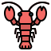
</p>

<h1 align="center">XClaw</h1>

<p align="center">
  <strong>The Desktop Interface for OpenClaw AI Agents</strong>
</p>

<p align="center">
  <a href="https://www.x-claw.shop/" target="_blank">🌐 Website</a> •
  <a href="#features">Features</a> •
  <a href="#getting-started">Getting Started</a> •
  <a href="#skills">Skills</a> •
  <a href="#development">Development</a>
</p>

<p align="center">
  
  
  
  <a href="https://discord.gg/h6YkTEuW" target="_blank">
  
  </a>
  
  
</p>

<p align="center">
  <a href="README.zh-CN.md">English</a> | <a href="README.zh-CN.md">简体中文</a>
</p>

---

## Overview

**XClaw** is a powerful desktop application that brings AI agents to everyone. Built on [OpenClaw](https://github.com/OpenClaw), it transforms command-line AI orchestration into an accessible, beautiful desktop experience.

**What makes XClaw different?**

- 🎯 **Zero Setup** - One-click setup wizard, no terminal required
- 💬 **Smart Chat** - Streaming responses, Markdown rendering, conversation history
- 📡 **Multi-Channel** - WhatsApp, Telegram, Discord integration
- ⏰ **Automated Tasks** - Cron scheduling with daily briefings
- 🧩 **50+ Skills** - Extend AI capabilities with pre-built skills
- 💳 **Subscription** - 500+ models, Alipay/WeChat support
- 👤 **Account Sync** - Login to sync across devices

🌐 **Learn more at [https://www.x-claw.shop/](https://www.x-claw.shop/)**

---

## Screenshots

### Setup Wizard

> Get started in minutes with our guided setup

<p align="center">
  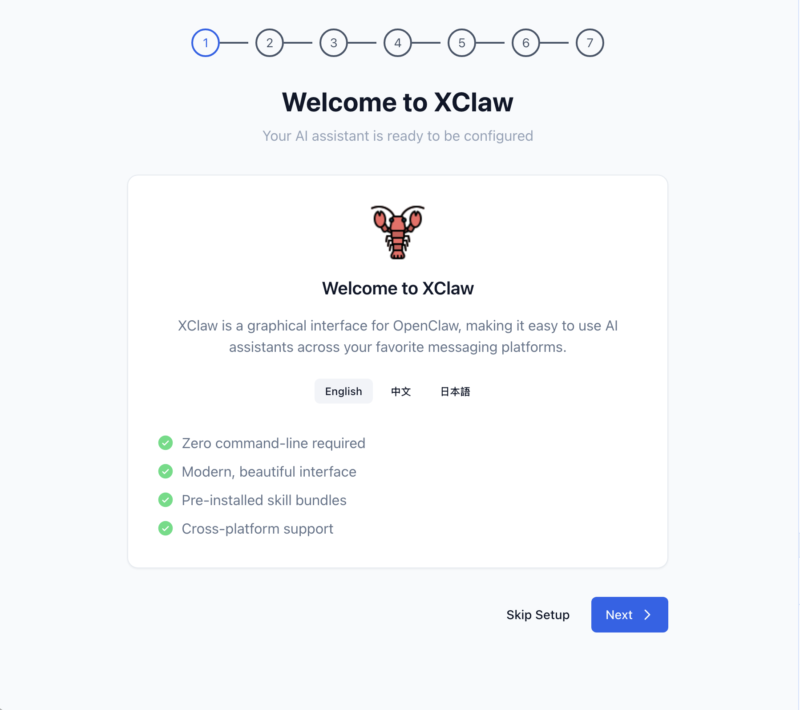
</p>

---

### Features

#### 💬 Chat

<p align="center">
  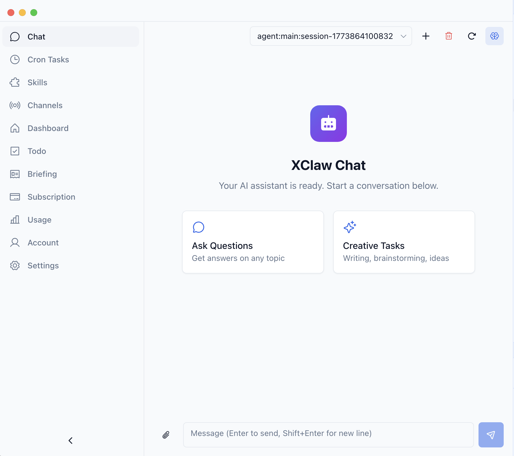
</p>

Real-time streaming responses with rich Markdown support, code blocks, tables, and images.

---

#### 📡 Channels

<p align="center">
  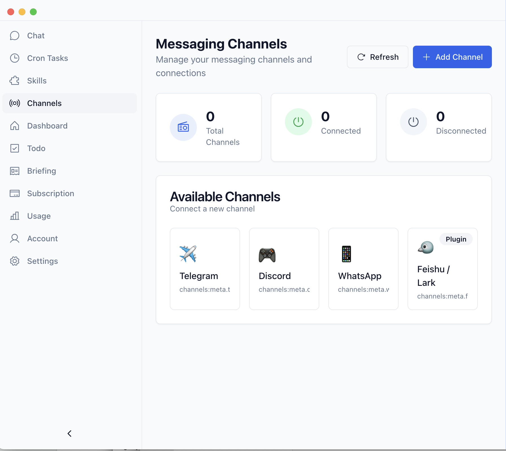
</p>

Connect WhatsApp, Telegram, and Discord for AI-powered messaging.

---

#### 🌅 Briefing

<p align="center">
  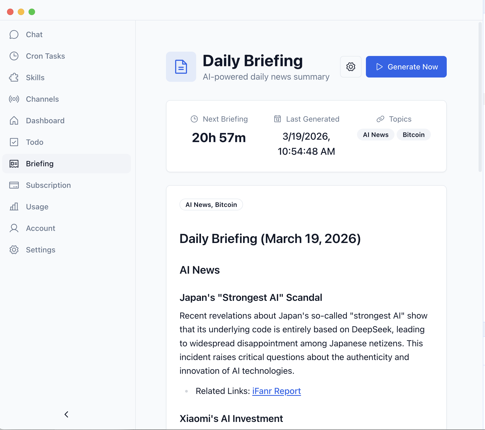
</p>

AI-generated daily news summaries with one-click deployment.

---

#### 📋 Todo

<p align="center">
  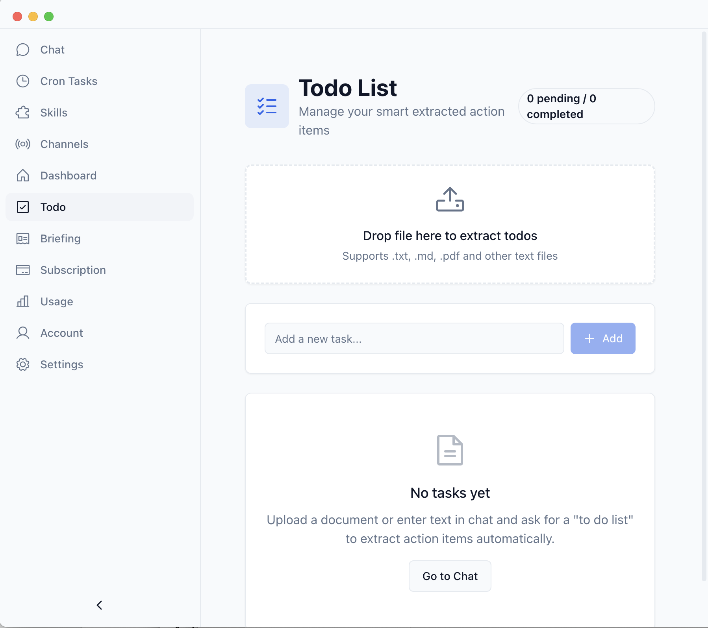
</p>

AI-powered task extraction from chat messages with drag & drop support.

---

#### 🧩 Skills

<p align="center">
  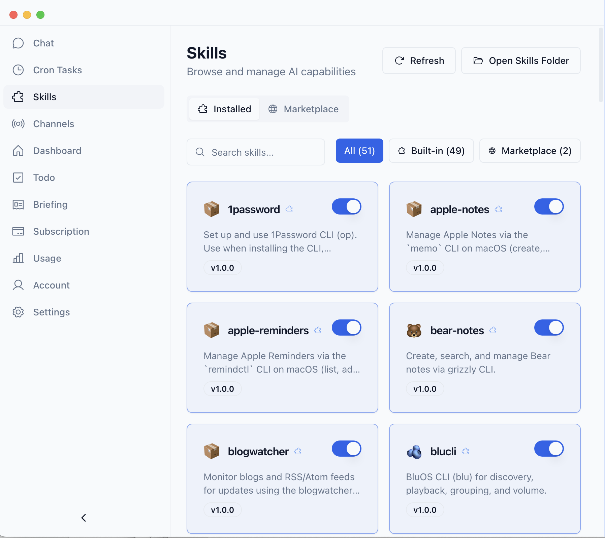
</p>

Browse and install skills from ClawHub with one click.

---

#### 💳 Subscription

<p align="center">
  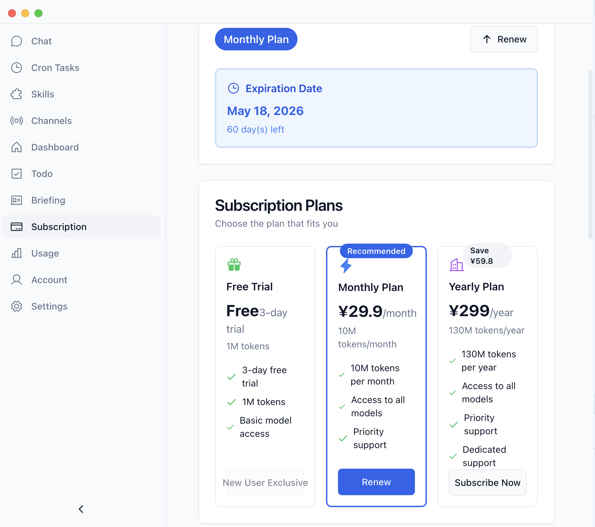
</p>

Access 500+ models with flexible subscription plans.

---

#### 📊 Usage

<p align="center">
  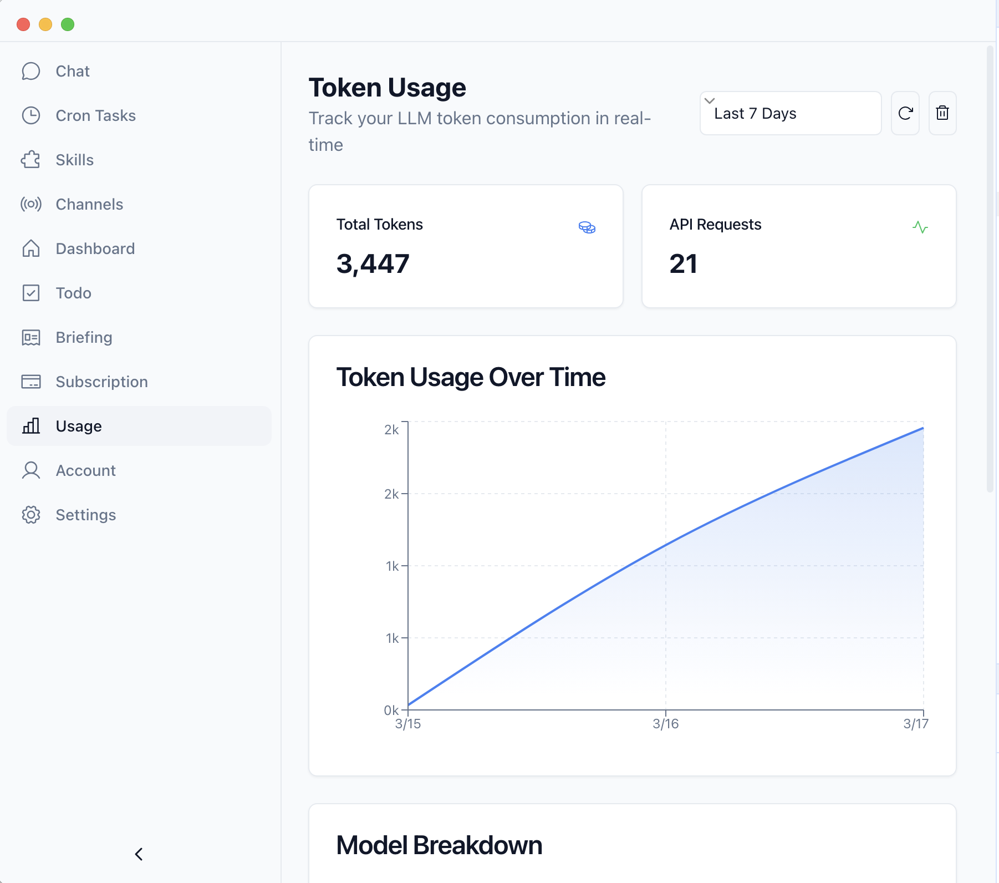
</p>

Real-time token usage monitoring with visual charts.

---

#### 👤 Account

<p align="center">
  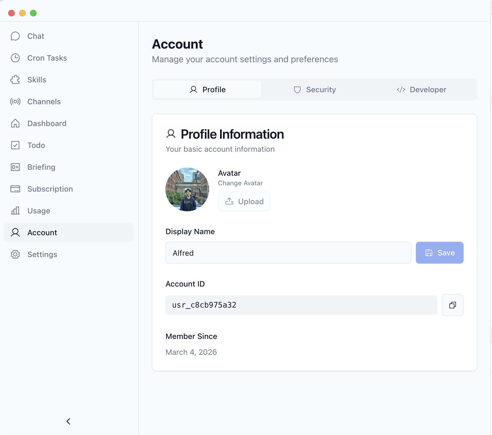
</p>

Profile settings, API keys management, and cross-device sync.

---

#### 📊 Dashboard

<p align="center">
  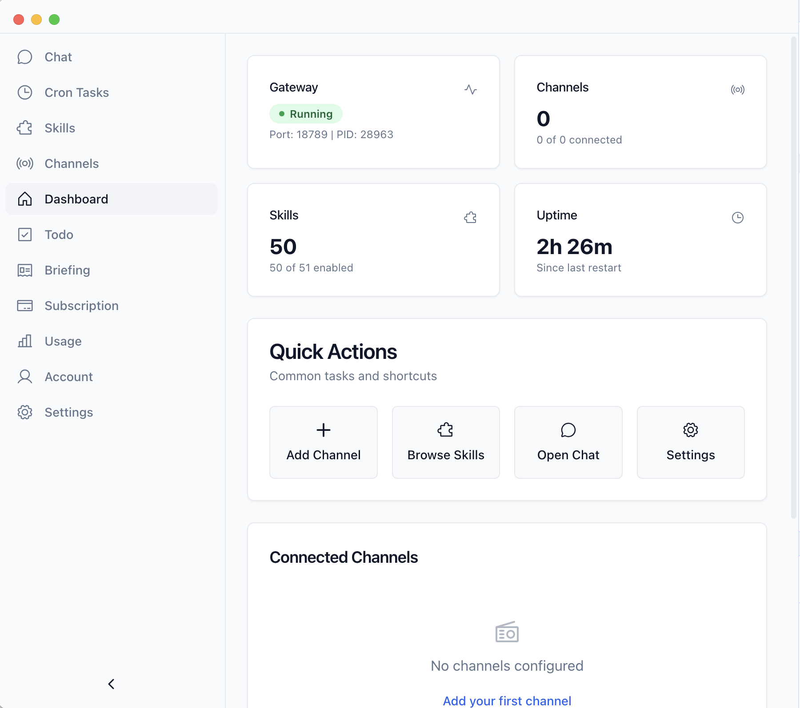
</p>

Overview of your AI assistant activity and statistics.

---

## Why XClaw

| Pain Point | XClaw Solution |
|------------|----------------|
| Can't use command line | Download and install—just works |
| Don't know how to configure OpenClaw | One-click setup wizard |
| Can't install skills | Browse and install with one click |
| Don't know which model to choose | Subscribe to access 500+ models |
| No idea how much token I'm using | Real-time token monitoring |
| Want daily AI news digest | One-click daily briefing |
| Need cross-device sync | Account login syncs all data |

---

## Skills

XClaw comes with **50+ pre-built skills** organized into categories:

### 📋 Productivity
| Skill | Description |
|-------|-------------|
| apple-notes | Manage Apple Notes via memo CLI |
| notion | Notion API integration |
| obsidian | Obsidian vault management |

### 💻 Developer Tools
| Skill | Description |
|-------|-------------|
| github | GitHub CLI integration (PR, Issues, CI) |
| tmux | Remote tmux session control |

### 🎨 Media & Creative
| Skill | Description |
|-------|-------------|
| openai-image-gen | OpenAI image generation |
| video-frames | FFmpeg video frame extraction |

### 🌐 Information
| Skill | Description |
|-------|-------------|
| weather | Weather queries (no API key needed) |
| summarize | URL/file summarization |

### 🎨 UI/Design Enhancement
- **frontend-design** - Create high-quality frontend interfaces
- **animate** - Add purposeful animations
- **polish** - Pre-release quality check
- **audit** - Comprehensive accessibility audit

---

## Getting Started

### System Requirements

- **OS**: macOS 11+, Windows 10+, or Linux (Ubuntu 20.04+)
- **Memory**: 4GB RAM minimum (8GB recommended)
- **Storage**: 1GB available disk space

### Installation

#### Pre-built Releases (Recommended)

Download from [Releases](https://github.com/ValueCell-ai/XClaw/releases):

| Platform | Architecture | Format |
|----------|-------------|--------|
| macOS | Intel (x64) | DMG, ZIP |
| macOS | Apple Silicon (arm64) | DMG, ZIP |
| Windows | x64, arm64 | NSIS Installer |
| Linux | x64, arm64 | AppImage, DEB, RPM |

#### Build from Source

```bash
# Clone the repository
git clone https://github.com/ValueCell-ai/XClaw.git
cd XClaw

# Initialize the project
pnpm run init

# Start in development mode
pnpm dev
```

---

## Architecture

```
┌─────────────────────────────────────────────────────────────────┐
│                        XClaw Desktop App                         │
│                                                                  │
│  ┌────────────────────────────────────────────────────────────┐  │
│  │              Electron Main Process                          │  │
│  │  • Window & application lifecycle                         │  │
│  │  • Gateway process supervision                             │  │
│  │  • System integration (tray, notifications, keychain)       │  │
│  └────────────────────────────────────────────────────────────┘  │
│                              │ IPC                                │
│  ┌────────────────────────────────────────────────────────────┐  │
│  │              React Renderer Process                          │  │
│  │  • Modern component-based UI (React 19)                    │  │
│  │  • State management with Zustand                            │  │
│  │  • Real-time WebSocket communication                        │  │
│  └────────────────────────────────────────────────────────────┘  │
└──────────────────────────────┬──────────────────────────────────┘
                               │ WebSocket (JSON-RPC)
                               ▼
┌─────────────────────────────────────────────────────────────────┐
│                     OpenClaw Gateway                              │
│  • AI agent runtime and orchestration                            │
│  • Message channel management                                    │
│  • Skill/plugin execution environment                            │
└─────────────────────────────────────────────────────────────────┘
```

### Tech Stack

| Layer | Technology |
|-------|------------|
| Runtime | Electron 40+ |
| UI Framework | React 19 + TypeScript |
| Styling | Tailwind CSS + Radix UI |
| State | Zustand |
| Icons | Phosphor Icons |
| Animation | Framer Motion |
| Build | Vite + electron-builder |

---

## Development

### Prerequisites

- **Node.js**: 22+ (LTS recommended)
- **Package Manager**: pnpm 10+

### Available Commands

```bash
# Development
pnpm dev                  # Start with hot reload

# Quality
pnpm lint                 # Run ESLint
pnpm typecheck            # TypeScript validation

# Testing
pnpm test                 # Run unit tests
pnpm test:e2e             # Run Playwright E2E tests

# Build & Package
pnpm build                # Full production build
pnpm package:mac          # Package for macOS
pnpm package:win          # Package for Windows
pnpm package:linux        # Package for Linux
```

---

## Community

| Discord |
| :---: |
| <a href="https://discord.gg/h6YkTEuW" target="_blank"></a> |

Join our Discord community: [https://discord.gg/h6YkTEuW](https://discord.gg/h6YkTEuW)

---

## License

XClaw is released under the [MIT License](LICENSE).

---

<p align="center">
  <sub>Built with ❤️ by the ValueCell Team</sub>
</p>
