<p align="center">
  
</p>

<h1 align="center">XClaw</h1>

<p align="center">
  <strong>The Desktop Interface for OpenClaw AI Agents</strong>
</p>

<p align="center">
  <a href="#features">Features</a> •
  <a href="#why-xclaw">Why XClaw</a> •
  <a href="#getting-started">Getting Started</a> •
  <a href="#skills">Skills</a> •
  <a href="#architecture">Architecture</a> •
  <a href="#development">Development</a>
</p>

<p align="center">
  
  
  
  <a href="https://discord.gg/h6YkTEuW" target="_blank">
  
  </a>
  
  
</p>

<p align="center">
  English | <a href="README.zh-CN.md">简体中文</a>
</p>

---

## Overview

**XClaw** is a powerful desktop application that brings AI agents to everyone. Built on [OpenClaw](https://github.com/OpenClaw), it transforms command-line AI orchestration into an accessible, beautiful desktop experience—no terminal required.

**What makes XClaw different?**

- 🎯 **Zero Setup Hassle** - Don't know how to configure OpenClaw? XClaw solves everything in one place
- 💬 **Smart Chat** - Stream responses, Markdown rendering, conversation history
- 📡 **Multi-Channel Integration** - Connect WhatsApp, Telegram, Discord for AI-powered messaging
- ⏰ **Automated Tasks** - One-click deployment of daily briefings, scheduled AI tasks
- 🧩 **50+ Built-in Skills** - Extend AI capabilities with pre-built skills
- 💳 **Subscription & Payment** - Built-in subscription with 500+ models, Alipay/WeChat support
- 👤 **Account Sync** - Login to sync across devices

---

## Why XClaw

XClaw solves the biggest pain points for AI newcomers:

| Pain Point | XClaw Solution |
|------------|----------------|
| Can't use command line | Download and install—just works |
| Don't know how to configure OpenClaw | One-click setup wizard guides you through |
| Can't install skills | Browse and install with one click in the skill store |
| Don't know which model to choose | Subscribe to access 500+ models instantly |
| No idea how much token I'm using | Real-time token usage monitoring |
| Want daily AI news digest | One-click daily briefing deployment |
| Forgot important items from chat | AI automatically extracts reminders from conversations |
| Need cross-device sync | Account login syncs all your data |

### OpenClaw Inside

XClaw embeds the official **OpenClaw** runtime, providing a seamless "battery-included" experience without requiring separate installation.

---

## Screenshots

### Setup Wizard

<p align="center">
  
</p>

<p align="center">
  
  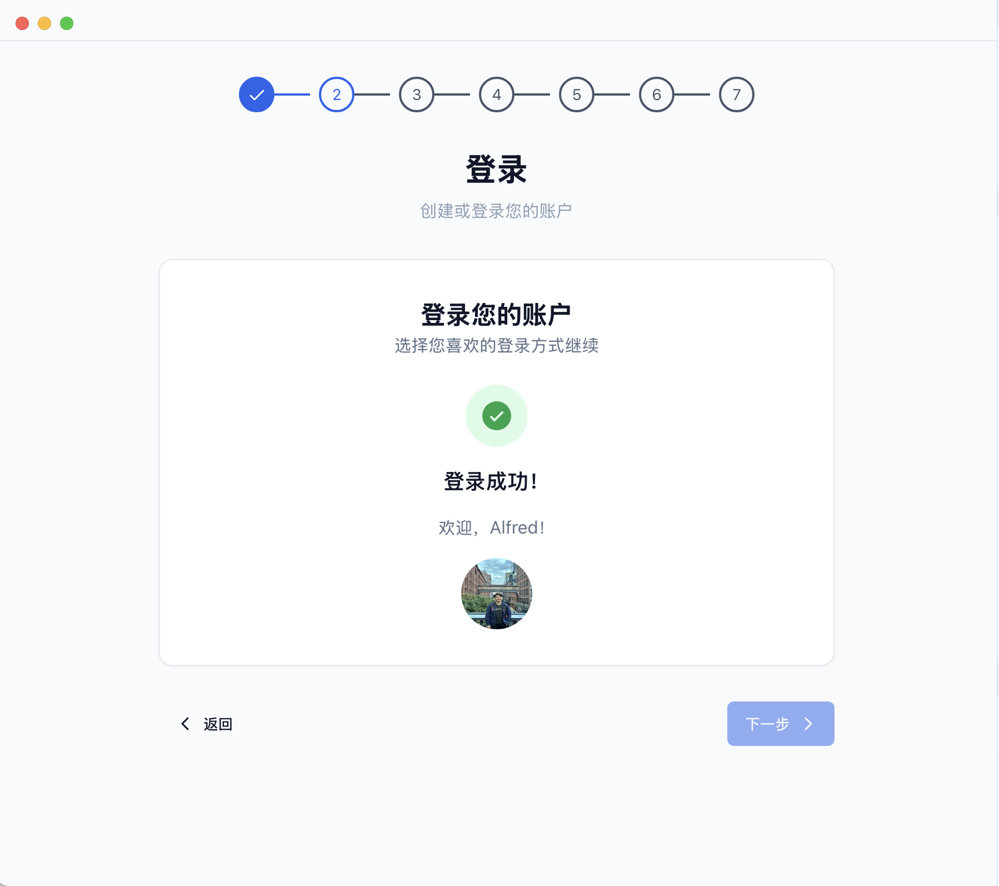
</p>

<p align="center">
  
</p>

<p align="center">
  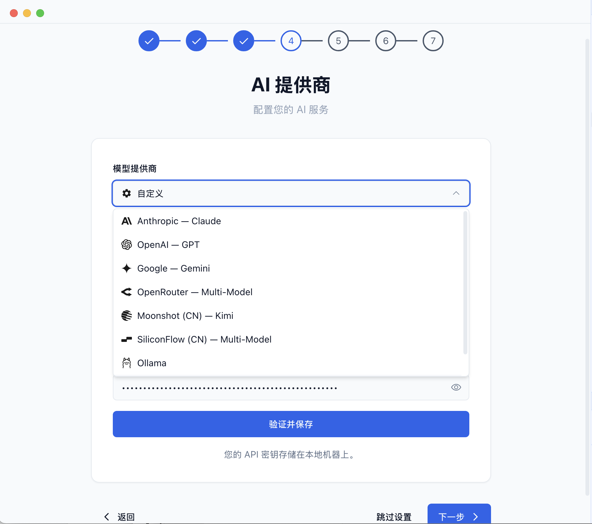
</p>

<p align="center">
  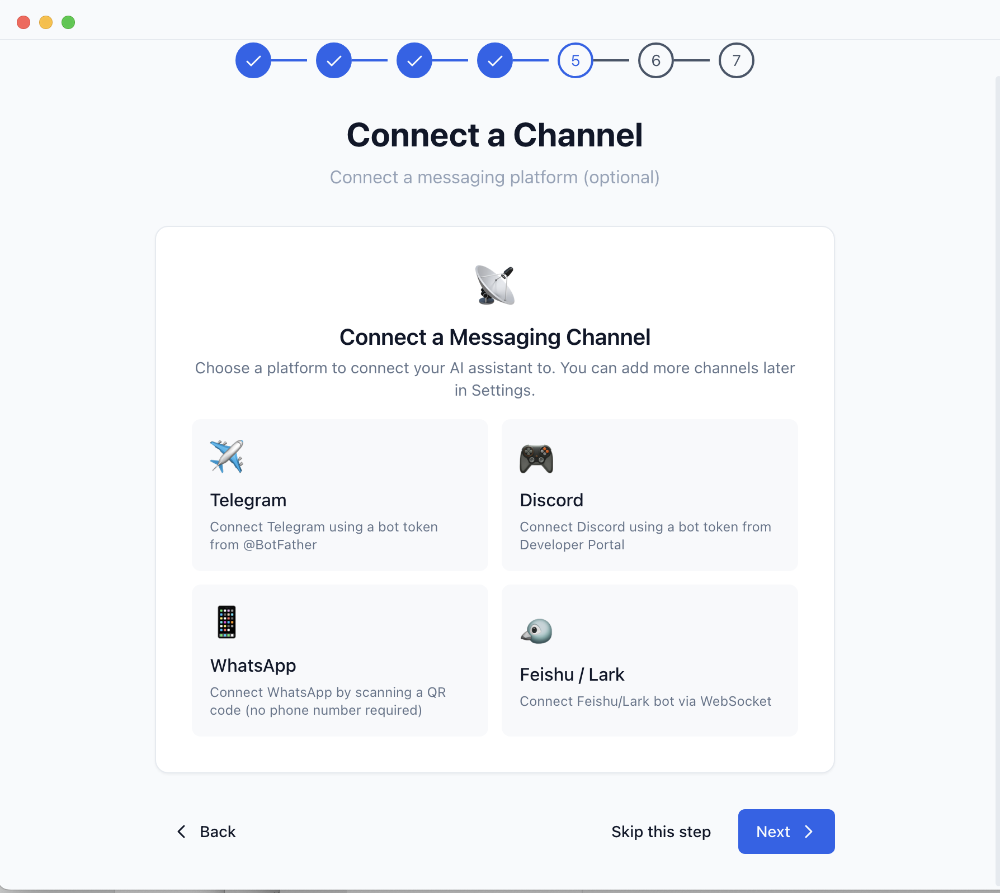
</p>

<p align="center">
  
</p>

<p align="center">
  
</p>

### Features

<p align="center">
  
</p>

<p align="center">
  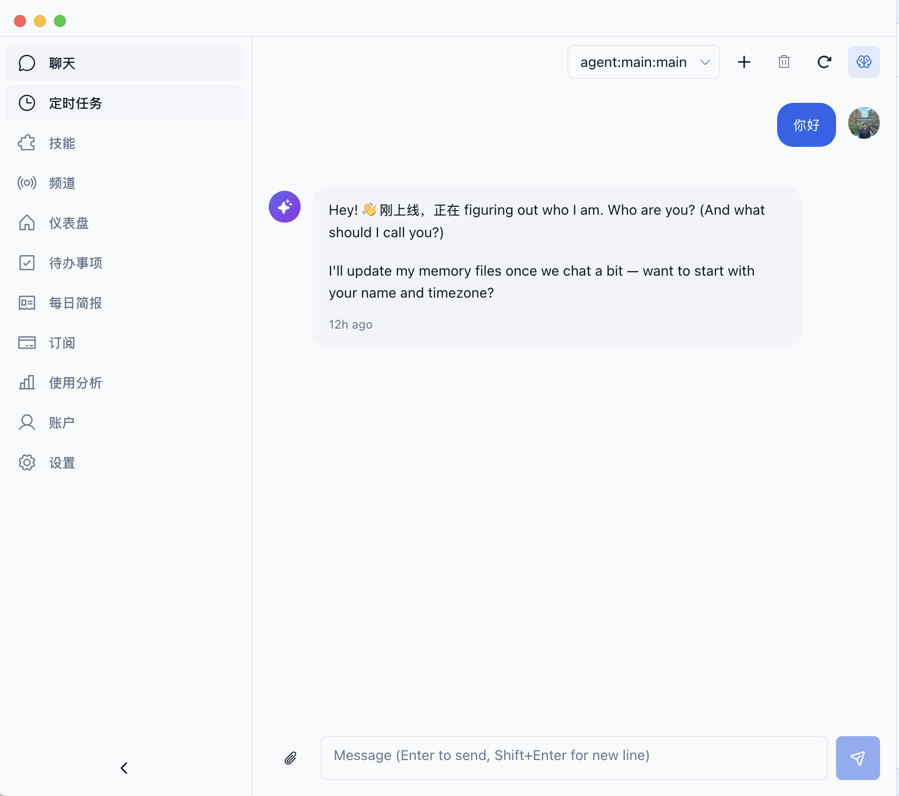
</p>

<p align="center">
  
</p>

<p align="center">
  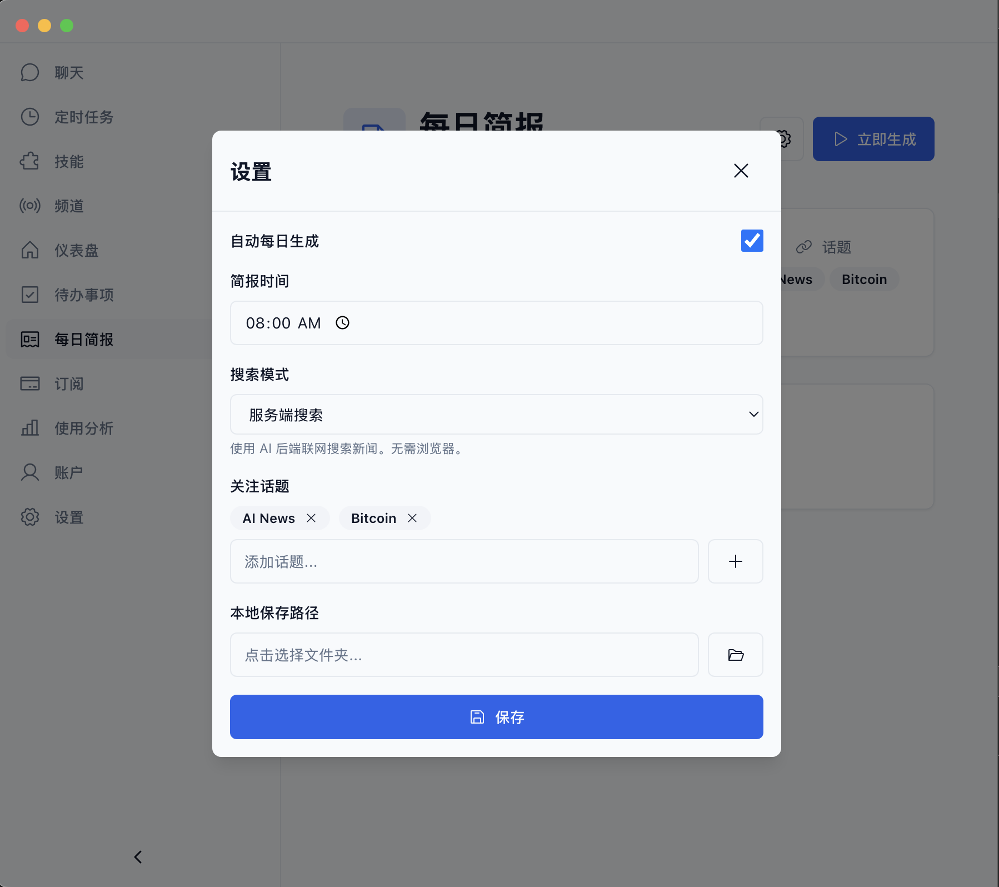
</p>

<p align="center">
  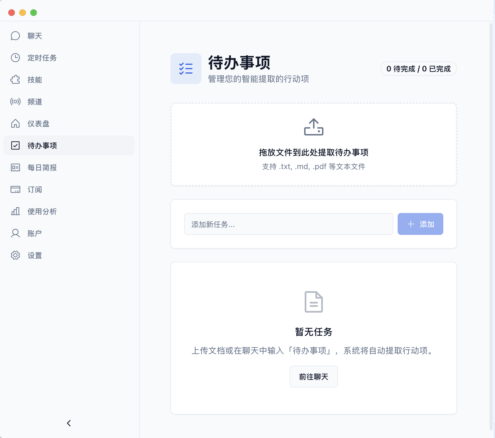
</p>

<p align="center">
  
</p>

<p align="center">
  
</p>

<p align="center">
  
</p>

<p align="center">
  
</p>

<p align="center">
  
</p>

<p align="center">
  
</p>

<p align="center">
  
</p>

<p align="center">
  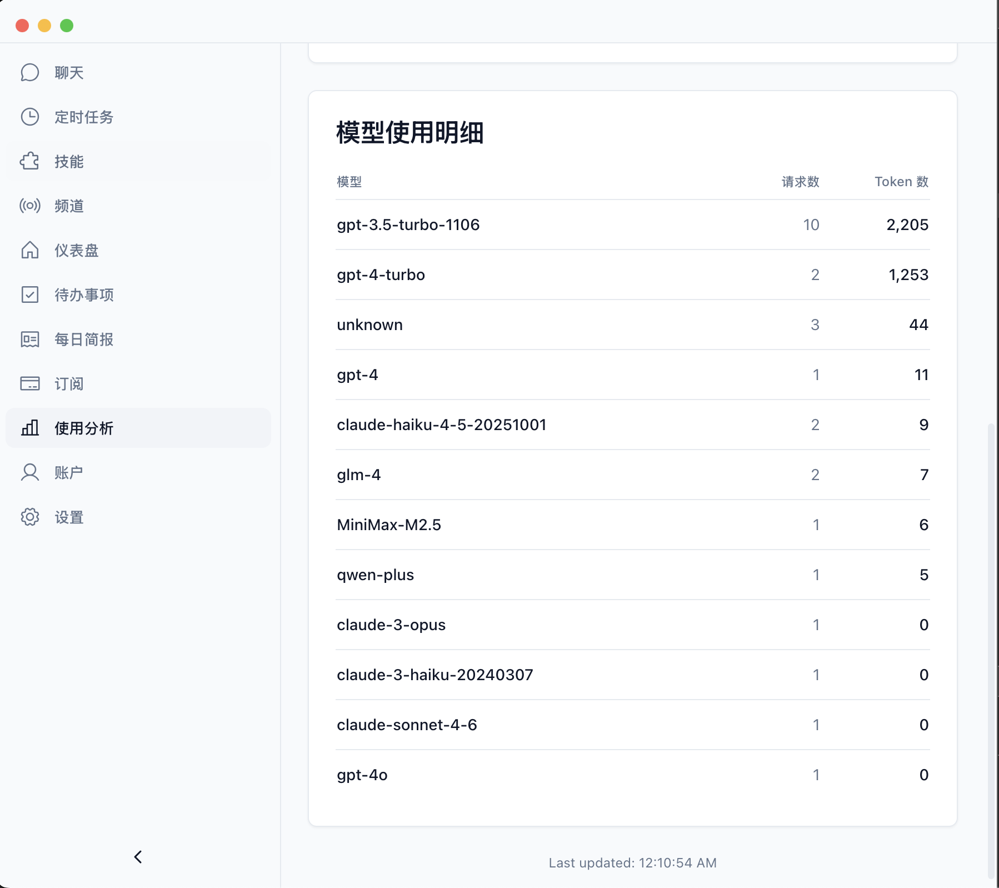
</p>

<p align="center">
  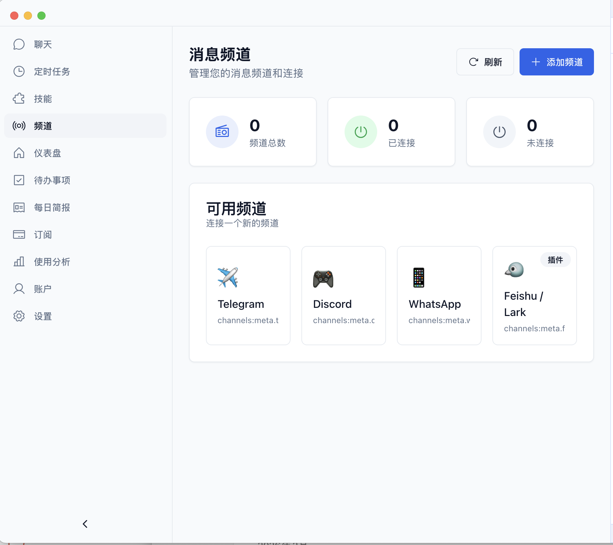
</p>

<p align="center">
  
</p>

<p align="center">
  
</p>

<p align="center">
  
</p>

<p align="center">
  
</p>

<p align="center">
  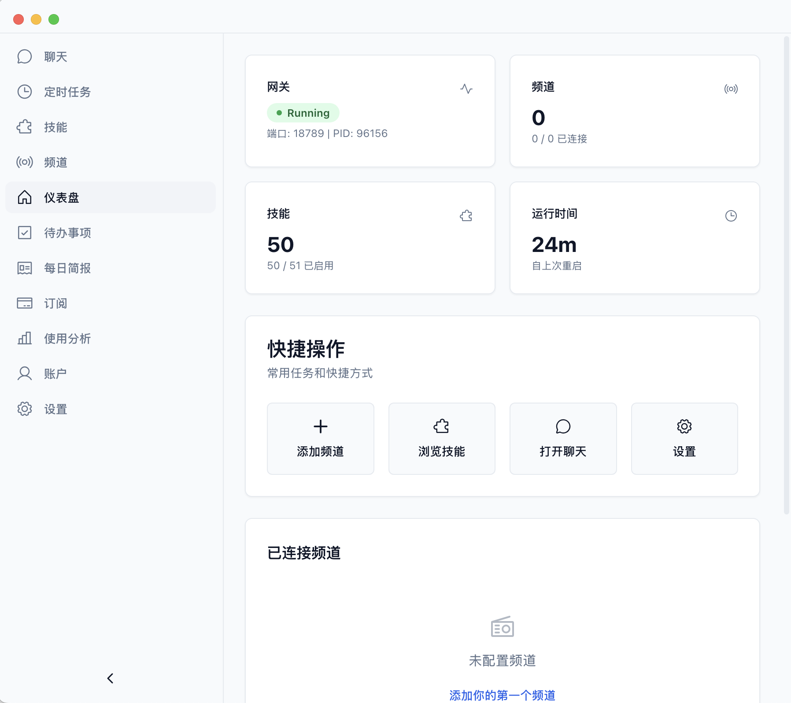
</p>

<p align="center">
  
</p>

<p align="center">
  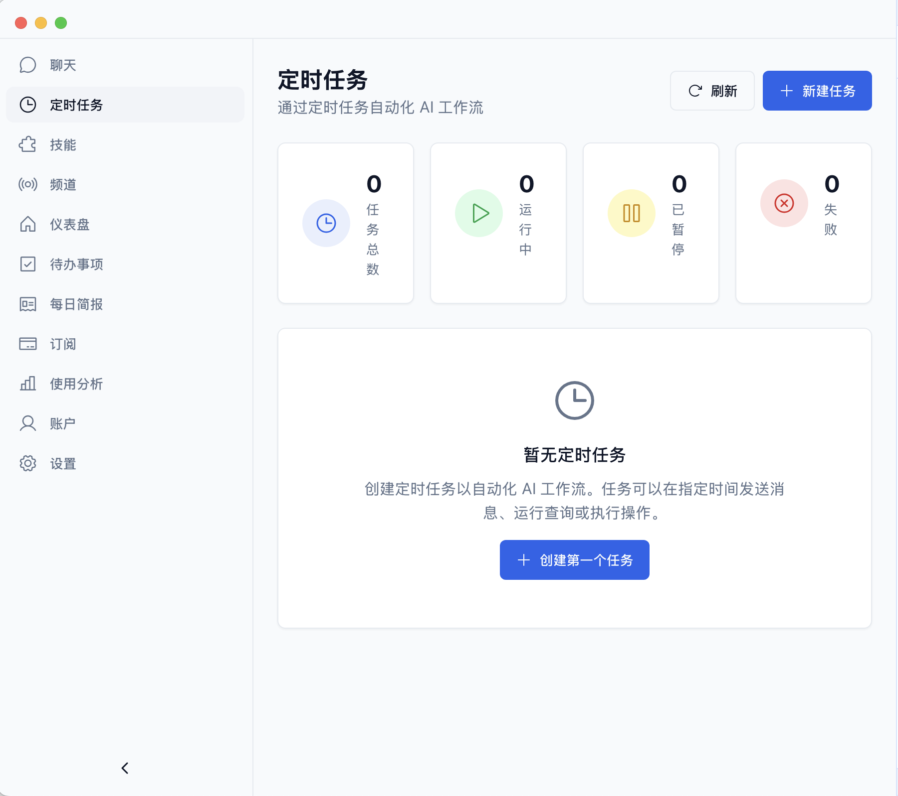
</p>

<p align="center">
  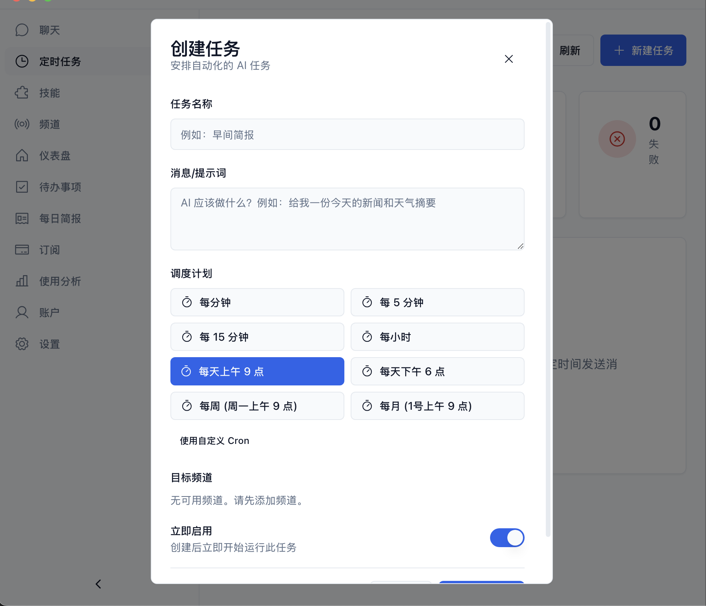
</p>

---

## Features

### 💬 Chat - AI Conversation
- Real-time streaming responses
- Rich Markdown rendering (code blocks, tables, images)
- Conversation history management
- Thinking process toggle for reasoning models
- Multi-model support (Claude, GPT, Gemini, etc.)
- 500+ models available via subscription

### 📡 Channels - Multi-Platform Integration
- **WhatsApp** - QR code scanning for quick login
- **Telegram** - Token-based authentication
- **Discord** - Bot token integration
- Credential validation and status monitoring

### ⏰ Cron - Scheduled Tasks
- Cron expression scheduler with visual editor
- Preset time templates (hourly, daily, weekly)
- Task execution history
- Manual trigger support
- Send results to specified channels

### 🧩 Skills - Extensible AI Capabilities
- Browse and search ClawHub skill marketplace
- One-click skill installation
- Skill configuration (API keys, environment variables)
- Enable/disable skills per channel
- 50+ built-in skills for productivity, development, smart home, and more

### 📊 Usage - Token Analytics
- Real-time token usage monitoring
- Visual token usage charts
- Time range filtering (7/30/90 days)
- Per-model statistics
- API request tracking

### 💳 Subscription - Payment Integration
- Subscription plans (Free, Monthly, Yearly)
- Access to 500+ models
- ZPay payment integration
- Alipay/WeChat Pay support
- Trial period for new users
- API token management with usage quotas

### 👤 Account - User Management
- Profile settings (avatar, display name)
- Developer settings (API keys management)
- Security settings
- Third-party account binding
- Cross-device sync

### 📋 Todo - Smart Task Management
- AI-powered task extraction from chat messages
- Drag & drop support (PDF, TXT, MD)
- Task status management
- Edit and delete tasks
- Automatic reminder extraction from conversations

### 🌅 Briefing - Daily Digest
- AI-generated daily news summaries
- One-click deployment
- Custom topic interests
- Obsidian integration for export
- Knowledge base and web search modes

---

## Skills

XClaw comes with **50+ pre-built skills** organized into categories:

### 📋 Productivity
| Skill | Description | Platform |
|-------|-------------|----------|
| apple-notes | Manage Apple Notes via memo CLI | macOS |
| apple-reminders | Manage Apple Reminders via remindctl | macOS |
| himalaya | IMAP/SMTP email management | Cross-platform |
| notion | Notion API integration | Cross-platform |
| obsidian | Obsidian vault management | Cross-platform |
| trello | Trello board management | Cross-platform |

### 💻 Developer Tools
| Skill | Description | Platform |
|-------|-------------|----------|
| github | GitHub CLI integration (PR, Issues, CI) | Cross-platform |
| tmux | Remote tmux session control | macOS/Linux |

### 🏠 Smart Home
| Skill | Description | Platform |
|-------|-------------|----------|
| openhue | Philips Hue light control | Cross-platform |
| sonoscli | Sonos speaker control | Cross-platform |
| spotify-player | Spotify playback control | Cross-platform |

### 🎨 Media & Creative
| Skill | Description | Platform |
|-------|-------------|----------|
| openai-image-gen | OpenAI image generation with gallery | Cross-platform |
| nano-banana-pro | Gemini 3 Pro image generation (1K/2K/4K) | Cross-platform |
| video-frames | FFmpeg video frame extraction | Cross-platform |

### 🌐 Information
| Skill | Description | Platform |
|-------|-------------|----------|
| weather | Weather queries (no API key needed) | Cross-platform |
| blogwatcher | RSS/blog subscription monitoring | Cross-platform |
| summarize | URL/file summarization | Cross-platform |

### 🎨 UI/Design Enhancement
Built-in skills for frontend development:
- **frontend-design** - Create high-quality frontend interfaces
- **animate** - Add purposeful animations and micro-interactions
- **polish** - Pre-release quality check
- **audit** - Comprehensive accessibility and performance audit
- And 20+ more design enhancement skills...

---

## Getting Started

### System Requirements

- **Operating System**: macOS 11+, Windows 10+, or Linux (Ubuntu 20.04+)
- **Memory**: 4GB RAM minimum (8GB recommended)
- **Storage**: 1GB available disk space

### Installation

#### Pre-built Releases (Recommended)

Download from [Releases](https://github.com/ValueCell-ai/XClaw/releases):

| Platform | Architecture | Format |
|----------|-------------|--------|
| macOS | Intel (x64) | DMG, ZIP |
| macOS | Apple Silicon (arm64) | DMG, ZIP |
| Windows | x64, arm64 | NSIS Installer |
| Linux | x64, arm64 | AppImage, DEB, RPM |

#### Build from Source

```bash
# Clone the repository
git clone https://github.com/ValueCell-ai/XClaw.git
cd XClaw

# Initialize the project (install deps + download uv)
pnpm run init

# Start in development mode
pnpm dev
```

### First Launch

The **Setup Wizard** guides you through:

1. **Language & Region** – Configure your preferred locale
2. **Account** – Login or create account for cross-device sync
3. **Subscription** – Choose a plan (Free, Monthly, Yearly) to access 500+ models
4. **Skill Bundles** – Select pre-configured skill packages
5. **Channels** (Optional) – Configure messaging platforms
6. **Dashboard** – View your overview

---

## Architecture

XClaw uses a **dual-process architecture**:

```
┌─────────────────────────────────────────────────────────────────┐
│                        XClaw Desktop App                         │
│                                                                  │
│  ┌────────────────────────────────────────────────────────────┐  │
│  │              Electron Main Process                          │  │
│  │  • Window & application lifecycle management               │  │
│  │  • Gateway process supervision                              │  │
│  │  • System integration (tray, notifications, keychain)      │  │
│  │  • Auto-update orchestration                                │  │
│  └────────────────────────────────────────────────────────────┘  │
│                              │ IPC                                │
│  ┌────────────────────────────────────────────────────────────┐  │
│  │              React Renderer Process                          │  │
│  │  • Modern component-based UI (React 19)                    │  │
│  │  • State management with Zustand                            │  │
│  │  • Real-time WebSocket communication                        │  │
│  │  • Rich Markdown rendering                                   │  │
│  └────────────────────────────────────────────────────────────┘  │
└──────────────────────────────┬──────────────────────────────────┘
                               │ WebSocket (JSON-RPC)
                               ▼
┌─────────────────────────────────────────────────────────────────┐
│                     OpenClaw Gateway                              │
│  • AI agent runtime and orchestration                           │
│  • Message channel management                                    │
│  • Skill/plugin execution environment                           │
│  • Provider abstraction layer                                   │
└─────────────────────────────────────────────────────────────────┘
```

### Tech Stack

| Layer | Technology |
|-------|------------|
| Runtime | Electron 40+ |
| UI Framework | React 19 + TypeScript |
| Styling | Tailwind CSS + Radix UI |
| State | Zustand |
| Icons | Phosphor Icons |
| Animation | Framer Motion |
| Build | Vite + electron-builder |
| Testing | Vitest + Playwright |
| Backend | Supabase (Auth, DB, Edge Functions) |

---

## Development

### Prerequisites

- **Node.js**: 22+ (LTS recommended)
- **Package Manager**: pnpm 10+ (recommended)

### Available Commands

```bash
# Development
pnpm dev                  # Start with hot reload

# Quality
pnpm lint                 # Run ESLint
pnpm typecheck            # TypeScript validation

# Testing
pnpm test                 # Run unit tests
pnpm test:e2e             # Run Playwright E2E tests

# Build & Package
pnpm build                # Full production build
pnpm package:mac          # Package for macOS (x64 + arm64)
pnpm package:win          # Package for Windows (x64 + arm64)
pnpm package:linux       # Package for Linux (AppImage, DEB, RPM)
```

### Project Structure

```
XClaw/
├── electron/              # Electron Main Process
│   ├── main/             # Application entry, window, tray
│   ├── gateway/           # OpenClaw Gateway manager
│   ├── preload/          # Secure IPC bridge
│   └── utils/            # Utilities (storage, auth)
├── src/                   # React Renderer Process
│   ├── components/       # UI components (Radix UI + shadcn/ui)
│   ├── pages/            # Application pages
│   ├── stores/           # Zustand state stores
│   ├── i18n/             # Internationalization (en, zh, ja)
│   └── lib/              # Frontend utilities
├── supabase/             # Backend
│   ├── functions/        # Edge Functions
│   └── migrations/       # Database migrations
├── skills/               # Built-in skills
└── resources/            # Static assets
```

---

## Contributing

We welcome contributions! See [Contributing Guidelines](CONTRIBUTING.md) for details.

1. Fork the repository
2. Create a feature branch (`git checkout -b feature/amazing-feature`)
3. Commit your changes with clear messages
4. Push to your branch
5. Open a Pull Request

---

## Community

| Discord |
| :---: |
| <a href="https://discord.gg/h6YkTEuW" target="_blank"></a> |

Join our Discord community: [https://discord.gg/h6YkTEuW](https://discord.gg/h6YkTEuW)

---

## License

XClaw is released under the [MIT License](LICENSE).

---

<p align="center">
  <sub>Built with ❤️ by the ValueCell Team</sub>
</p>
