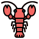
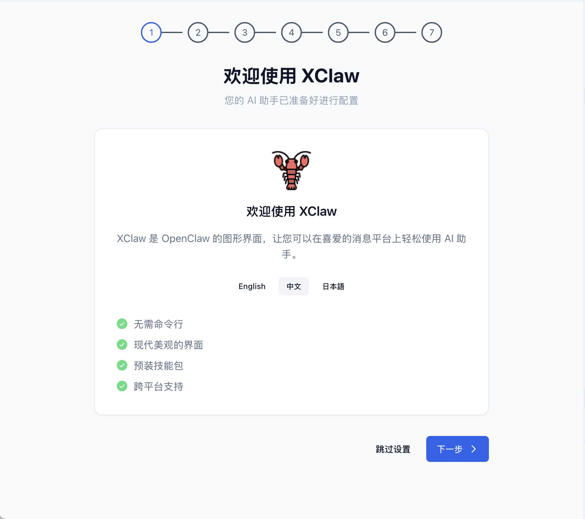
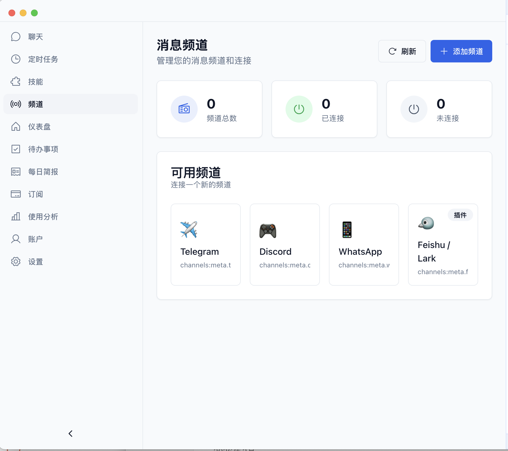
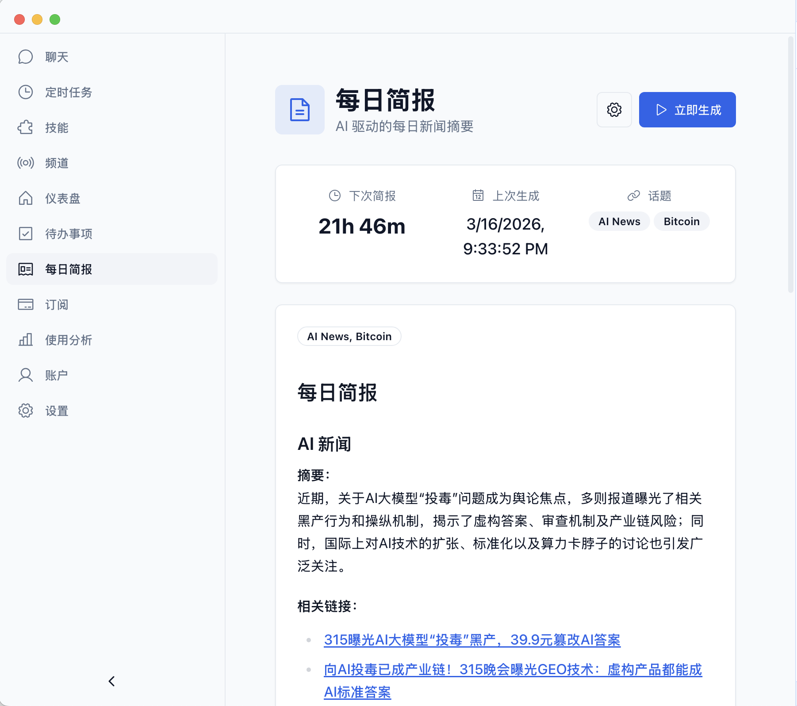
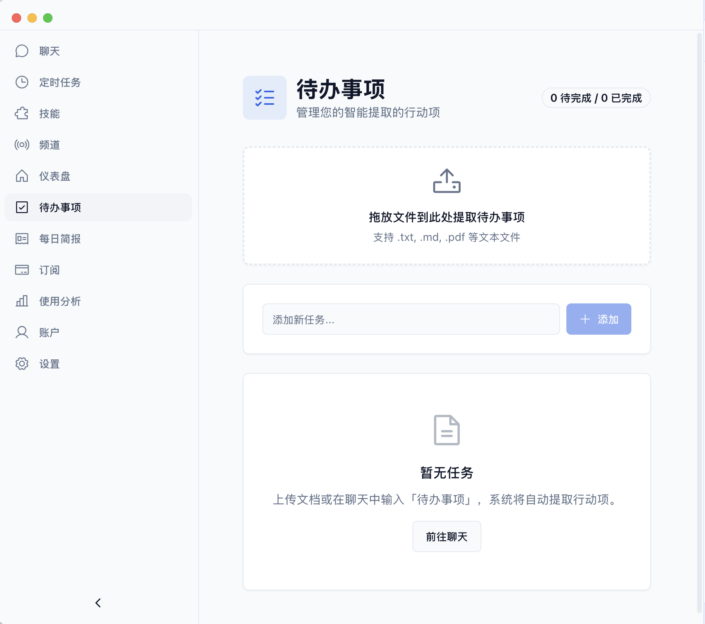
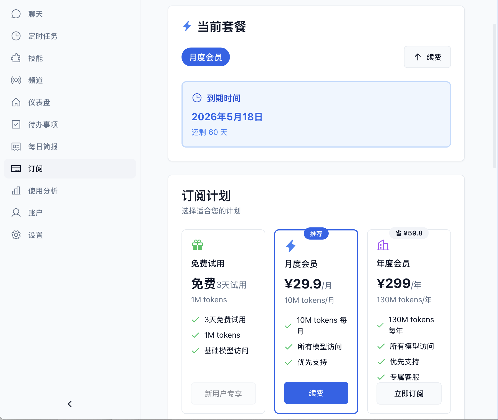
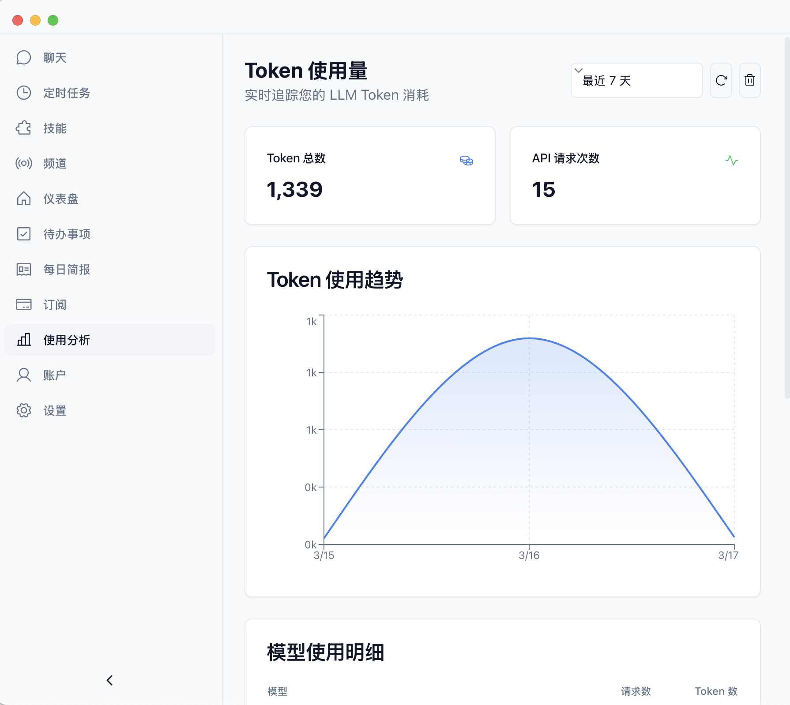
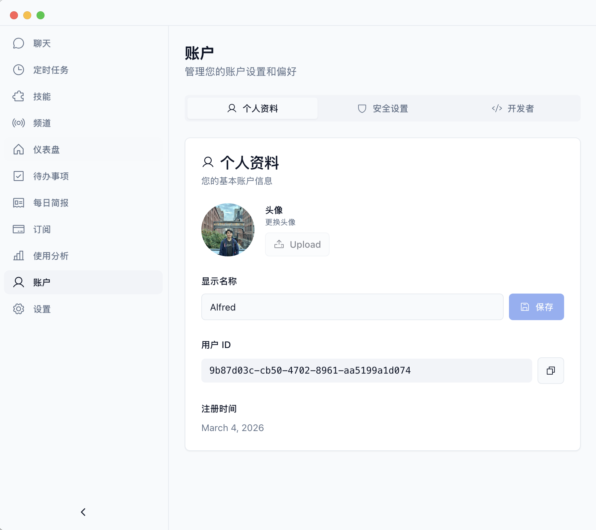
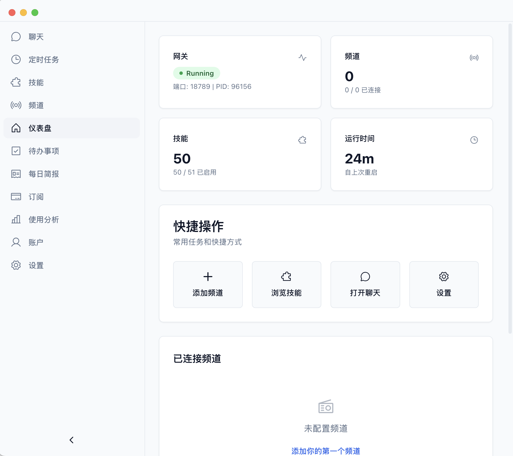

<p align="center">
  
</p>

<h1 align="center">XClaw</h1>

<p align="center">
  <strong>OpenClaw AI 智能体的桌面客户端</strong>
</p>

<p align="center">
  <a href="https://www.x-claw.shop/" target="_blank">🌐 网站</a> •
  <a href="#功能特性">功能特性</a> •
  <a href="#快速上手">快速上手</a> •
  <a href="#技能系统">技能系统</a> •
  <a href="#开发指南">开发指南</a>
</p>

<p align="center">
  
  
  
  <a href="https://discord.gg/h6YkTEuW" target="_blank">
  
  </a>
  
  
</p>

<p align="center">
  <a href="README.md">English</a> | 简体中文
</p>

---

## 概述

**XClaw** 是一款强大的桌面应用，让每个人都能轻松使用 AI 智能体。基于 [OpenClaw](https://github.com/OpenClaw) 构建，将命令行式的 AI 编排转变为易用、美观的桌面体验。

**XClaw 的独特之处：**

- 🎯 **零配置门槛** - 一键安装向导，无需终端
- 💬 **智能聊天** - 流式响应、Markdown 渲染、会话历史
- 📡 **多渠道集成** - WhatsApp、Telegram、Discord 消息收发
- ⏰ **自动化任务** - Cron 定时调度与每日简报
- 🧩 **50+ 内置技能** - 预构建技能扩展 AI 能力
- 💳 **订阅与支付** - 500+ 模型可选，支付宝/微信支付
- 👤 **账户同步** - 登录账户，跨设备同步

🌐 **了解更多：[https://www.x-claw.shop/](https://www.x-claw.shop/)**

---

## 截图预览

### 安装向导

> 几分钟内即可开始使用

<p align="center">
  
</p>

---

### 功能展示

#### 💬 聊天

<p align="center">
  
</p>

实时流式响应，支持 Markdown 富文本、代码块、表格和图片。

---

#### 📡 渠道

<p align="center">
  
</p>

连接 WhatsApp、Telegram 和 Discord，实现 AI 消息收发。

---

#### 🌅 简报

<p align="center">
  
</p>

AI 生成的每日新闻摘要，一键部署。

---

#### 📋 待办

<p align="center">
  
</p>

AI 自动从聊天消息中提取待办事项，支持拖放上传。

---

#### 🧩 技能

<p align="center">
  
</p>

浏览并一键安装 ClawHub 技能市场的各种技能。

---

#### 💳 订阅

<p align="center">
  
</p>

灵活的订阅计划，访问 500+ 模型。

---

#### 📊 用量统计

<p align="center">
  
</p>

实时 Token 用量监测，可视化图表分析。

---

#### 👤 账户

<p align="center">
  
</p>

个人资料设置、API Keys 管理和跨设备同步。

---

#### 📊 仪表盘

<p align="center">
  
</p>

AI 助手活动概览和统计数据。

---

## 为什么选择 XClaw

| 痛点 | XClaw 解决方案 |
|------|----------------|
| 不会用命令行 | 下载安装包，直接运行 |
| 不会配置 OpenClaw | 一键式安装向导 |
| 不会安装技能 | 技能商店点击安装 |
| 不知道选什么模型 | 订阅会员，500+ 模型任选 |
| 不知道用了多少 Token | 实时用量监测 |
| 想要每日 AI 新闻简报 | 一键部署每日简报 |
| 需要跨设备同步 | 账户登录，数据同步 |

---

## 技能系统

XClaw 内置 **50+ 预构建技能**，按类别组织：

### 📋 效率办公
| 技能 | 描述 |
|------|------|
| apple-notes | 通过 memo CLI 管理 Apple Notes |
| notion | Notion API 集成 |
| obsidian | Obsidian vault 管理 |

### 💻 开发者工具
| 技能 | 描述 |
|------|------|
| github | GitHub CLI 集成（PR、Issue、CI） |
| tmux | 远程控制 tmux 会话 |

### 🎨 多媒体创作
| 技能 | 描述 |
|------|------|
| openai-image-gen | OpenAI 图像生成 |
| video-frames | FFmpeg 视频帧提取 |

### 🌐 信息获取
| 技能 | 描述 |
|------|------|
| weather | 天气查询（无需 API Key） |
| summarize | URL/文件摘要 |

### 🎨 UI/设计增强
- **frontend-design** - 创建高质量前端界面
- **animate** - 添加有目的的动画和微交互
- **polish** - 发布前质量检查
- **audit** - 全面质量审计

---

## 快速上手

### 系统要求

- **操作系统**：macOS 11+、Windows 10+ 或 Linux（Ubuntu 20.04+）
- **内存**：最低 4GB RAM（推荐 8GB）
- **存储空间**：1GB 可用磁盘空间

### 安装方式

#### 预构建版本（推荐）

从 [Releases](https://github.com/ValueCell-ai/XClaw/releases) 下载：

| 平台 | 架构 | 格式 |
|------|------|------|
| macOS | Intel (x64) | DMG, ZIP |
| macOS | Apple Silicon (arm64) | DMG, ZIP |
| Windows | x64, arm64 | NSIS 安装包 |
| Linux | x64, arm64 | AppImage, DEB, RPM |

#### 从源码构建

```bash
# 克隆仓库
git clone https://github.com/ValueCell-ai/XClaw.git
cd XClaw

# 初始化项目
pnpm run init

# 以开发模式启动
pnpm dev
```

---

## 系统架构

```
┌─────────────────────────────────────────────────────────────────┐
│                        XClaw 桌面应用                             │
│                                                                  │
│  ┌────────────────────────────────────────────────────────────┐  │
│  │              Electron 主进程                                 │  │
│  │  • 窗口与应用生命周期管理                                    │  │
│  │  • 网关进程监控                                             │  │
│  │  • 系统集成（托盘、通知、密钥链）                                │  │
│  └────────────────────────────────────────────────────────────┘  │
│                              │ IPC                                │
│  ┌────────────────────────────────────────────────────────────┐  │
│  │              React 渲染进程                                   │  │
│  │  • 现代组件化 UI（React 19）                                   │  │
│  │  • Zustand 状态管理                                           │  │
│  │  • WebSocket 实时通信                                         │  │
│  └────────────────────────────────────────────────────────────┘  │
└──────────────────────────────┬──────────────────────────────────┘
                               │ WebSocket (JSON-RPC)
                               ▼
┌─────────────────────────────────────────────────────────────────┐
│                     OpenClaw 网关                                 │
│  • AI 智能体运行时与编排                                          │
│  • 消息频道管理                                                   │
│  • 技能/插件执行环境                                              │
└─────────────────────────────────────────────────────────────────┘
```

### 技术栈

| 层级 | 技术 |
|------|------|
| 运行时 | Electron 40+ |
| UI 框架 | React 19 + TypeScript |
| 样式 | Tailwind CSS + Radix UI |
| 状态管理 | Zustand |
| 图标 | Phosphor Icons |
| 动画 | Framer Motion |
| 构建工具 | Vite + electron-builder |

---

## 开发指南

### 前置要求

- **Node.js**：22+（推荐 LTS 版本）
- **包管理器**：pnpm 10+

### 常用命令

```bash
# 开发
pnpm dev                  # 以热重载模式启动

# 代码质量
pnpm lint                 # 运行 ESLint 检查
pnpm typecheck            # TypeScript 类型检查

# 测试
pnpm test                 # 运行单元测试
pnpm test:e2e             # 运行 Playwright E2E 测试

# 构建与打包
pnpm build                # 完整生产构建
pnpm package:mac          # 为 macOS 打包
pnpm package:win          # 为 Windows 打包
pnpm package:linux        # 为 Linux 打包
```

---

## 社区

| Discord |
| :---: |
| <a href="https://discord.gg/h6YkTEuW" target="_blank"></a> |

加入我们的 Discord 社区： [https://discord.gg/h6YkTEuW](https://discord.gg/h6YkTEuW)

---

## 许可证

XClaw 基于 [MIT 许可证](LICENSE) 发布。

---

<p align="center">
  <sub>由 ValueCell 团队用 ❤️ 打造</sub>
</p>
