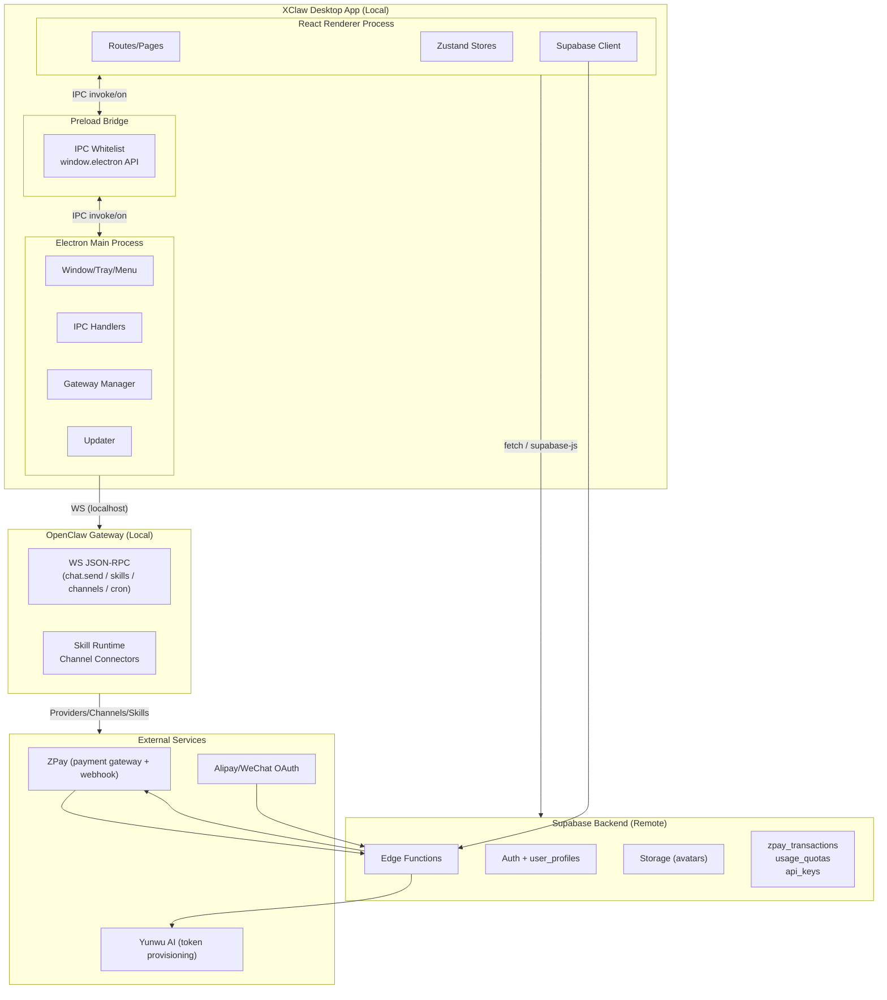

# XClaw Architecture Map

This document summarizes the end-to-end architecture for XClaw, including the desktop app, local gateway, Supabase backend, and external payment/login services.

## Mermaid Diagram

## Component Map

### Desktop App (Local)

- Electron Main Process: window lifecycle, IPC handlers, auto-update, and gateway management.
- Preload Bridge: whitelisted IPC surface exposed to the renderer.
- React Renderer: routes, pages, stores, and UI state.

Key files:
- [electron/main/index.ts](/Users/wugaoyi/Learning/Project/ClawX/electron/main/index.ts)
- [electron/main/ipc-handlers.ts](/Users/wugaoyi/Learning/Project/ClawX/electron/main/ipc-handlers.ts)
- [electron/preload/index.ts](/Users/wugaoyi/Learning/Project/ClawX/electron/preload/index.ts)
- [src/main.tsx](/Users/wugaoyi/Learning/Project/ClawX/src/main.tsx)
- [src/App.tsx](/Users/wugaoyi/Learning/Project/ClawX/src/App.tsx)

### OpenClaw Gateway (Local)

The main process starts and supervises the gateway. The renderer uses IPC to request RPC calls, which the main process forwards over WS JSON-RPC.

Key files:
- [electron/gateway/manager.ts](/Users/wugaoyi/Learning/Project/ClawX/electron/gateway/manager.ts)
- [electron/gateway/protocol.ts](/Users/wugaoyi/Learning/Project/ClawX/electron/gateway/protocol.ts)

### Supabase Backend (Remote)

Supabase provides Auth, database, storage, and Edge Functions. The renderer uses `@supabase/supabase-js` directly for session management and uses Edge Functions for login, subscription, and profile-related actions.

Key files:
- [supabase/functions](/Users/wugaoyi/Learning/Project/ClawX/supabase/functions)
- [supabase/migrations](/Users/wugaoyi/Learning/Project/ClawX/supabase/migrations)
- [src/lib/supabase.ts](/Users/wugaoyi/Learning/Project/ClawX/src/lib/supabase.ts)
- [src/stores/auth.ts](/Users/wugaoyi/Learning/Project/ClawX/src/stores/auth.ts)
- [src/stores/account.ts](/Users/wugaoyi/Learning/Project/ClawX/src/stores/account.ts)

### External Services

- Alipay/WeChat OAuth: login QR flow via `auth-init` and `auth-callback`.
- ZPay: payment creation + webhook callback for subscription upgrade.
- Yunwu AI: token provisioning after payment or trial.

Key files:
- [docs/alipay_login.md](/Users/wugaoyi/Learning/Project/ClawX/docs/alipay_login.md)
- [docs/yunwu-api.md](/Users/wugaoyi/Learning/Project/ClawX/docs/yunwu-api.md)
- [src/lib/payment.ts](/Users/wugaoyi/Learning/Project/ClawX/src/lib/payment.ts)
- [supabase/functions/zpay-create/index.ts](/Users/wugaoyi/Learning/Project/ClawX/supabase/functions/zpay-create/index.ts)
- [supabase/functions/zpay-notify/index.ts](/Users/wugaoyi/Learning/Project/ClawX/supabase/functions/zpay-notify/index.ts)

## Core Flows

### Login (Alipay / WeChat)

1. Renderer calls `auth-init` to create `auth_sessions` and generate OAuth URL.
2. User scans QR and completes OAuth; provider redirects to `auth-callback`.
3. Edge Function validates auth code, creates/binds user, and marks session complete.
4. Renderer polls `auth-session-status` then calls `get-session` to exchange for Supabase session.

Relevant files:
- [supabase/functions/auth-init/index.ts](/Users/wugaoyi/Learning/Project/ClawX/supabase/functions/auth-init/index.ts)
- [supabase/functions/auth-callback/index.ts](/Users/wugaoyi/Learning/Project/ClawX/supabase/functions/auth-callback/index.ts)
- [supabase/functions/auth-session-status/index.ts](/Users/wugaoyi/Learning/Project/ClawX/supabase/functions/auth-session-status/index.ts)
- [supabase/functions/get-session/index.ts](/Users/wugaoyi/Learning/Project/ClawX/supabase/functions/get-session/index.ts)
- [src/lib/supabase.ts](/Users/wugaoyi/Learning/Project/ClawX/src/lib/supabase.ts)

### Payment + Subscription

1. Renderer calls `zpay-create` with the selected plan; user completes payment in ZPay.
2. ZPay hits `zpay-notify` webhook to verify and mark payment success.
3. `zpay-notify` upgrades `user_profiles`, updates `usage_quotas`, and creates/updates Yunwu token.
4. Renderer polls `zpay-status`, then refreshes profile/quota/token.

Relevant files:
- [src/lib/payment.ts](/Users/wugaoyi/Learning/Project/ClawX/src/lib/payment.ts)
- [supabase/functions/zpay-create/index.ts](/Users/wugaoyi/Learning/Project/ClawX/supabase/functions/zpay-create/index.ts)
- [supabase/functions/zpay-status/index.ts](/Users/wugaoyi/Learning/Project/ClawX/supabase/functions/zpay-status/index.ts)
- [supabase/functions/zpay-notify/index.ts](/Users/wugaoyi/Learning/Project/ClawX/supabase/functions/zpay-notify/index.ts)
- [supabase/functions/yunwu-token-status/index.ts](/Users/wugaoyi/Learning/Project/ClawX/supabase/functions/yunwu-token-status/index.ts)
